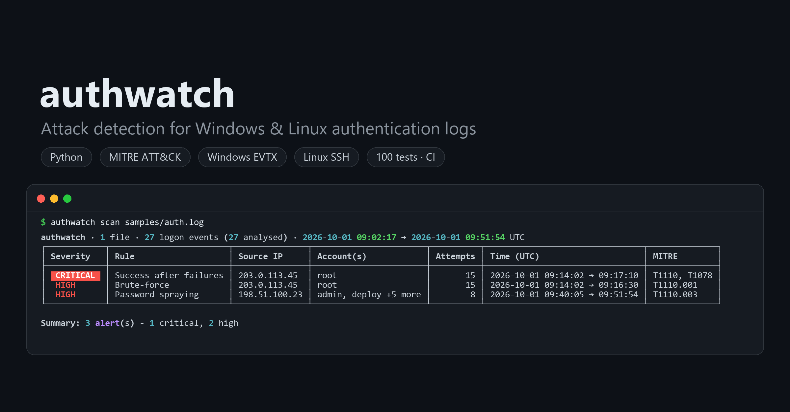

# authwatch

[](https://github.com/faded14444/Authwatch-Log-Analyzer/actions/workflows/ci.yml)



**authwatch** reads raw authentication logs - **Windows Security logs (`.evtx`)** and
**Linux SSH logs (`auth.log` / `secure`)** - and detects attacks the way a SOC analyst would
triage them: brute-force, password spraying, and - most importantly - a successful logon
right after a run of failures.

Every alert is mapped to **MITRE ATT&CK**, has a severity, and explains itself in one sentence.

<details>
<summary>Full text output of <code>authwatch scan samples/auth.log</code> (incl. per-alert details)</summary>

```
$ authwatch scan samples/auth.log
authwatch · 1 file · 27 logon events (27 analysed) · 2026-10-01 09:02:17 → 2026-10-01 09:51:54 UTC
┌──────────┬────────────────────────┬───────────────┬───────────────────────┬──────────┬────────────────────────────────┬──────────────┐
│ Severity │ Rule                   │ Source IP     │ Account(s)            │ Attempts │ Time (UTC)                     │ MITRE        │
├──────────┼────────────────────────┼───────────────┼───────────────────────┼──────────┼────────────────────────────────┼──────────────┤
│ CRITICAL │ Success after failures │ 203.0.113.45  │ root                  │       15 │ 2026-10-01 09:14:02 → 09:17:10 │ T1110, T1078 │
│ HIGH     │ Brute-force            │ 203.0.113.45  │ root                  │       15 │ 2026-10-01 09:14:02 → 09:16:30 │ T1110.001    │
│ HIGH     │ Password spraying      │ 198.51.100.23 │ admin, deploy +5 more │        8 │ 2026-10-01 09:40:05 → 09:51:54 │ T1110.003    │
└──────────┴────────────────────────┴───────────────┴───────────────────────┴──────────┴────────────────────────────────┴──────────────┘
Details
  1. CRITICAL Account 'root' logged on successfully from 203.0.113.45 after 15 failed attempts against this same account - verify this logon
  2. HIGH 15 failed logons for account 'root' from 203.0.113.45 within 2m 28s
  3. HIGH 8 failed logons against 7 different accounts from 198.51.100.23 within 11m 49s

Summary: 3 alert(s) - 1 critical, 2 high
```
</details>

<sub>Both the image and the text above are real output for the synthetic demo log <a href="samples/auth.log"><code>samples/auth.log</code></a> - run <code>authwatch scan samples/auth.log</code> to reproduce it.</sub>

## Features

- **Windows:** parses native `.evtx` files directly - no manual export to CSV needed
- **Linux:** parses OpenSSH logs from Debian/Ubuntu (`auth.log`) and RHEL/Fedora (`secure`),
  including rotated `.gz` files, classic and RFC 3339 syslog timestamps
- **Active Directory:** reads domain-controller events - Kerberos (4768, 4771) and NTLM
  (4776) - where password spraying against a domain is actually visible
- Three detection rules mapped to MITRE ATT&CK, shared by all log sources
- Sliding time windows: one long attack produces **one** alert, not hundreds
- Noise filtering of local, loopback and machine-account logons (common false positives)
- Colour terminal report, **JSON output** for a SIEM, a script or `jq`, and a
  **self-contained HTML report** with an attack timeline
- Robust: a corrupted record, chunk or line is skipped and reported, not fatal
- Script-friendly exit codes: `0` no alerts, `1` alerts found, `2` error

## Installation

Requires Python 3.11+.

```bash
git clone https://github.com/faded14444/Authwatch-Log-Analyzer.git
cd Authwatch-Log-Analyzer
python -m venv .venv
.venv\Scripts\activate          # Linux/macOS: source .venv/bin/activate
pip install -e ".[dev]"
```

## Usage

```bash
# try it on the bundled demo log
authwatch scan samples/auth.log

# Windows Security log
authwatch scan Security.evtx

# Linux: current and rotated logs at once
authwatch scan /var/log/auth.log /var/log/auth.log.1 /var/log/auth.log.2.gz

# domain controller Security log, with an HTML report for the ticket
authwatch scan DC01-Security.evtx --html report.html

# a whole folder (searched recursively for *.evtx, auth.log*, secure*),
# only high+ alerts, save JSON
authwatch scan logs/ --min-severity high --output alerts.json

# tune thresholds for a noisier environment
authwatch scan Security.evtx --bf-threshold 20 --bf-window 10
```

Where to get a log:
- **Windows** (a machine you administer): Event Viewer → Windows Logs → Security →
  *Save All Events As…* (`.evtx`).
- **Linux:** `/var/log/auth.log` (Debian/Ubuntu) or `/var/log/secure` (RHEL/Fedora). On
  journald-only systems: `journalctl -u ssh -o short > auth.log`.

See [`samples/`](samples/README.md) for the demo log and public attack recordings.

## What counts as a logon

| Source | Failure | Success |
|---|---|---|
| Windows `.evtx` | event **4625** (an account failed to log on) | event **4624** (an account was successfully logged on) |
| Domain controller - Kerberos | **4771** pre-auth failed with `0x18` wrong password or `0x12` account disabled/locked; **4768** with `0x6` unknown account | **4768** TGT issued (`0x0`) |
| Domain controller - NTLM | **4776** with `0xC000006A` wrong password, `0xC0000064` unknown account, `0xC000006D`, `0xC0000072` disabled, `0xC0000234` locked out | **4776** with `0x0` |
| Linux SSH | `Failed password for [invalid user] NAME from IP` | `Accepted <method> for NAME from IP` |

Other result codes are skipped on purpose: a Kerberos clock-skew error (`0x25`) or an
expired password (`0x17`) is an IT problem, not someone guessing credentials. NTLM event
4776 records **no IP address**, only the client workstation name - authwatch then uses that
name as the source of the attempt. IPv4-mapped addresses (`::ffff:10.0.0.5`, common in
4768) are normalised to IPv4, so one attacker is never split into two sources.

On Linux, other lines about the same attempt (`Invalid user …`, `pam_unix(sshd:auth):
authentication failure`, `Connection closed …`) are deliberately **ignored** - counting them
too would report each attempt two or three times. rsyslog's
`message repeated N times: [ … ]` is expanded, so collapsed lines are still counted.

## Detection rules

| Rule | Groups by | Fires when (default) | Severity | MITRE ATT&CK |
|---|---|---|---|---|
| **Brute-force** | source + account | ≥ 10 failures within 5 min | high | [T1110.001](https://attack.mitre.org/techniques/T1110/001/) Password Guessing |
| **Password spraying** | source | ≥ 5 *distinct accounts* failing within 30 min | high | [T1110.003](https://attack.mitre.org/techniques/T1110/003/) Password Spraying |
| **Success after failures** | source | a success preceded by ≥ 5 failures within 10 min | **critical** | [T1110](https://attack.mitre.org/techniques/T1110/) → [T1078](https://attack.mitre.org/techniques/T1078/) Valid Accounts |

*Source* = the source IP address, or the workstation name for NTLM events that carry no IP.

## Tested on a real attack

Besides synthetic tests, authwatch is checked against `kerberos_pwd_spray_4771.evtx` from
[EVTX-ATTACK-SAMPLES](https://github.com/sbousseaden/EVTX-ATTACK-SAMPLES) - a recording of
a real password-spraying run against a domain controller:

```
$ authwatch scan samples/kerberos_pwd_spray_4771.evtx
CRITICAL  Success after failures  172.16.66.1  normal          9  2020-07-22 20:29:36  T1110, T1078
HIGH      Password spraying       172.16.66.1  admin, … +7     9  2020-07-22 20:29:36  T1110.003
  1. CRITICAL Account 'normal' logged on successfully from 172.16.66.1 after 9 failed attempts
     against other accounts - verify this logon
  2. HIGH 9 failed logons against 9 different accounts from 172.16.66.1 within 0s
```

Nine accounts were tried within 20 milliseconds (7 that do not exist - Kerberos `0x6` - and
2 with a wrong password - `0x18`), then the attacker obtained a ticket for `normal`. The two
successful requests were logged once as `172.16.66.1` and once as `::ffff:172.16.66.1`; IP
normalisation merges them into a single alert. This check runs as a test
(`tests/test_kerberos_ntlm.py`) whenever the sample is present - see
[`samples/`](samples/README.md).

## HTML report

`--html report.html` writes one self-contained file: summary cards, a timeline of failed
and successful logons with alert windows shaded behind the bars, and the alert table with
links to MITRE ATT&CK. It uses no JavaScript and loads nothing from the internet, so it
opens on an air-gapped SOC workstation and can be attached to a ticket as-is. Every value
taken from the logs is HTML-escaped: account and host names can be attacker-controlled, and
a report that rendered them raw would itself be an XSS vector.

Account names are compared the way each OS does it: **case-insensitive on Windows**
(`ADMIN` = `admin`), **case-sensitive on Linux** (`Root` and `root` are different users).

### Why these thresholds?

Every threshold trades **sensitivity** (catching slow, careful attackers) against
**false positives** (users who mistype their password a few times). The defaults are a
starting point:

- **Brute-force 10 / 5 min.** A human who forgot their password rarely fails more than 3–5
  times before giving up or getting locked out. Ten failures in five minutes is machine speed.
- **Spraying 5 accounts / 30 min.** Sprayers deliberately go *slow and wide* to stay under
  the account-lockout policy, so this rule counts **distinct accounts** over a longer window
  instead of raw attempts. One host failing against five different accounts is very
  unusual for legitimate traffic.
- **Success after failures 5 / 10 min.** This is the alert that matters most: the attack may
  have worked. It is rated critical and should be verified with the account owner. The
  description says whether the successful account was itself under attack or was a
  different account (typical after a spray).

All thresholds can be changed from the command line (`authwatch scan --help`).

### Noise filtering

Before detection, authwatch drops events that are almost always benign:
no source IP (`-`), loopback addresses, machine accounts (`HOST$`) and `ANONYMOUS LOGON`.
All of these rules live in [`filters.py`](src/authwatch/filters.py).

**One deliberate exception:** RDP logons (logon type 10) from `127.0.0.1` are *kept*.
RDP from localhost is never normal - it is the fingerprint of RDP tunnelling (ngrok, plink,
chisel). A naive "drop all loopback" filter would make a brute-force attack through such a
tunnel completely invisible. This gap was found by testing against a real RDP-tunnelling
recording from EVTX-ATTACK-SAMPLES.

### Known limitations

- Classic syslog lines (`Oct  1 09:14:02 …`) have **no year and no timezone**. authwatch
  takes the year of the file's last modification (override with `--linux-year`), handles
  the December → January rollover, and treats the times as UTC. RFC 3339 timestamps
  (`2026-10-01T09:14:02+02:00`) carry both and are converted exactly.
- Distributed attacks from many IPs (one attempt per IP) are not correlated yet.
- Logs from a domain controller and from a member server describe the same attempt twice
  (e.g. 4625 on the server + 4776 on the DC). Scanning both together counts it in both
  places; scan them separately when exact counts matter.
- All times are reported in UTC.

## Architecture

```
 parsers/                  filters.py       detectors/                 reporters/
┌────────────────────┐    ┌───────────┐    ┌───────────────────────┐   ┌──────────┐
│ evtx_parser        │──▶ │  drop     │──▶ │ brute_force           │──▶│ console  │
│ linux_auth_parser  │    │  noise    │    │ password_spray        │   │ json     │
│  (→ AuthEvent)     │    └───────────┘    │ success_after_failures│   └──────────┘
└────────────────────┘                     └───────────────────────┘
```

Each parser converts its log format into a common `AuthEvent`
([`models.py`](src/authwatch/models.py)). Detectors only ever see `AuthEvent`s, so the
Linux parser was added as **one new parser file** plus a routing rule in
[`parsers/__init__.py`](src/authwatch/parsers/__init__.py) - the detection rules and
reports did not change.

## Development

```bash
pytest          # 130+ tests: rules (incl. edge cases), all parsers, filters, reports, CLI
ruff check .    # lint
```

Detection rules are tested on hand-built event sequences (no log files needed), covering
the edges: one below the threshold, attempts spread just outside the window, long attacks
that must produce a single alert, and account-name case rules per OS. The Linux parser is
tested line by line (repeated messages, `invalid user`, year rollover, gzip, RFC 3339) and
end-to-end on the demo log.

## Roadmap

- [x] Windows Security `.evtx` parser
- [x] Linux SSH `auth.log` / `secure` parser
- [x] Domain controller events: Kerberos (4768, 4771) and NTLM (4776)
- [x] HTML report with a timeline chart
- [ ] Correlation of distributed attacks across many source IPs

## Responsible use

authwatch is a **defensive** tool for analysing logs from systems you own or are
authorised to monitor. `samples/auth.log` is synthetic and uses documentation-only IP
ranges (RFC 5737); third-party recordings referenced in `samples/` come from public
research datasets - see that folder for sources.
